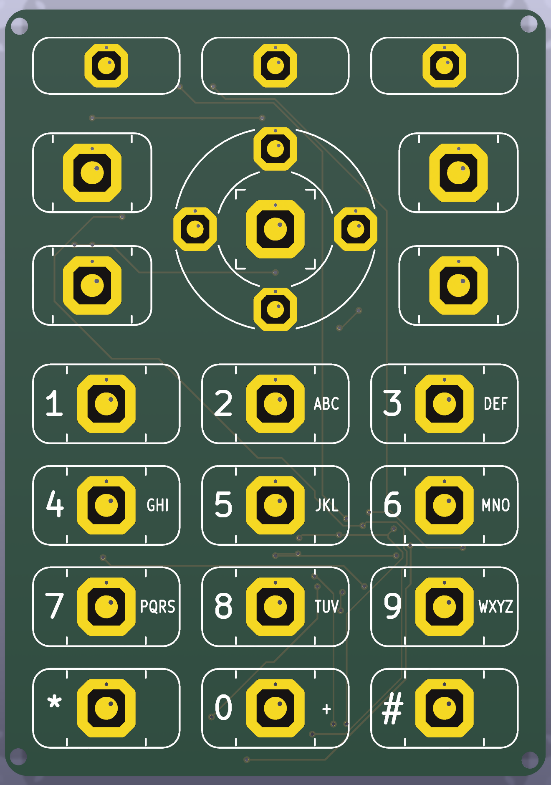
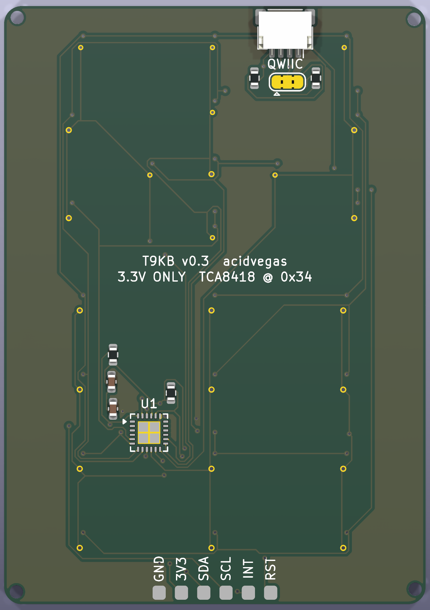
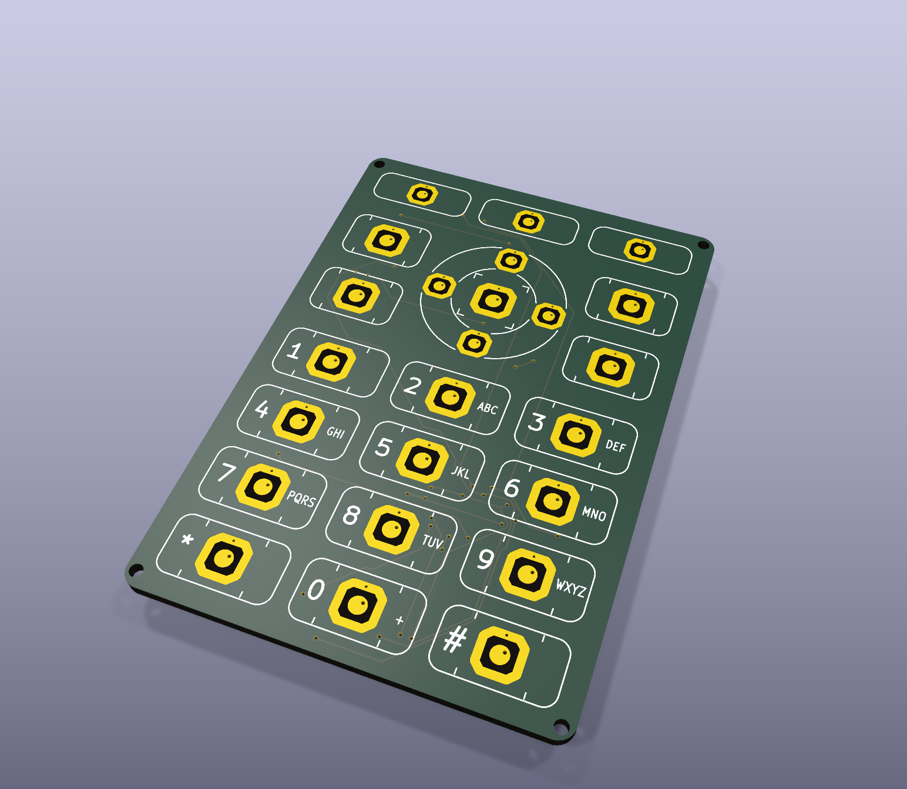
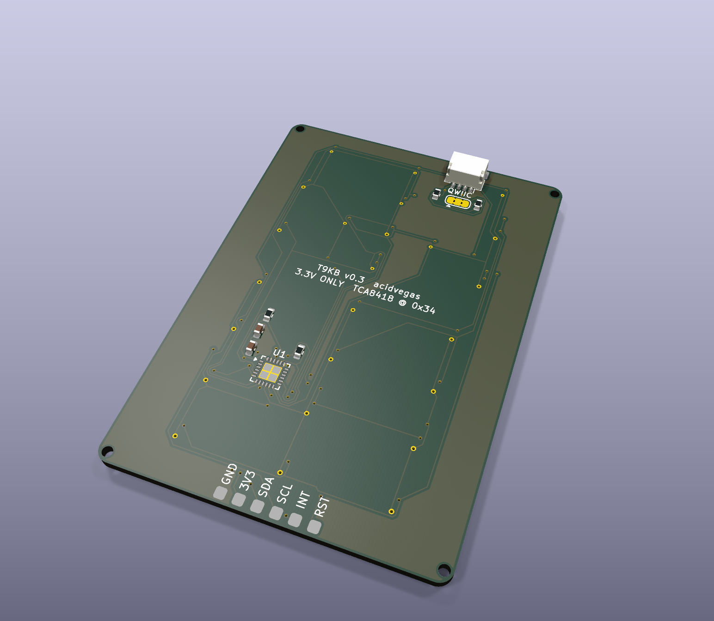
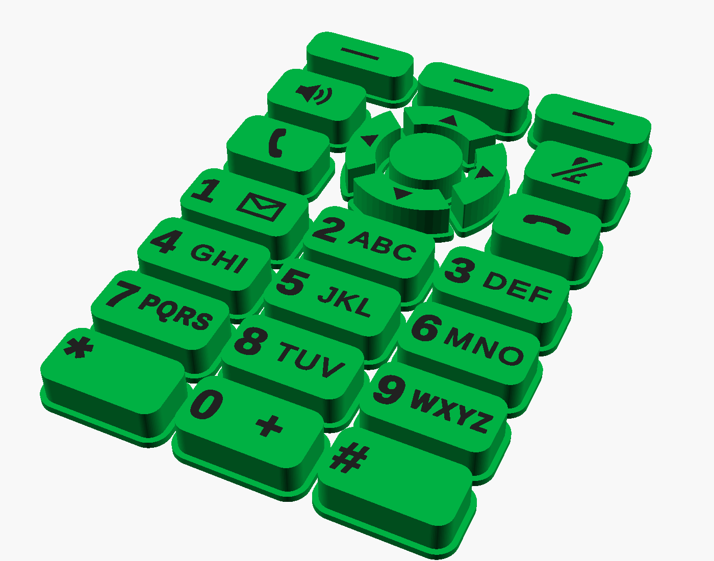
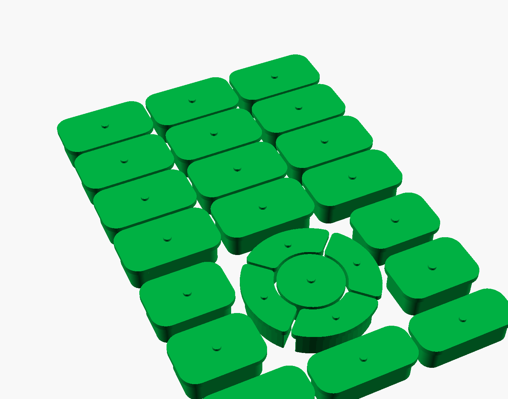
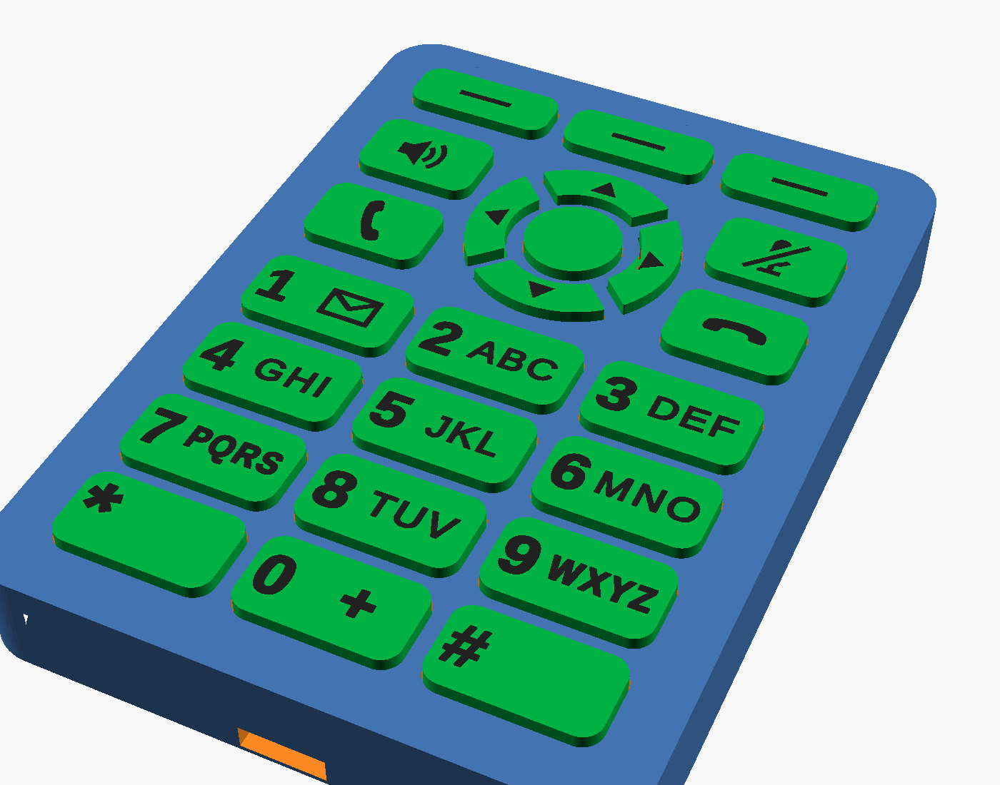
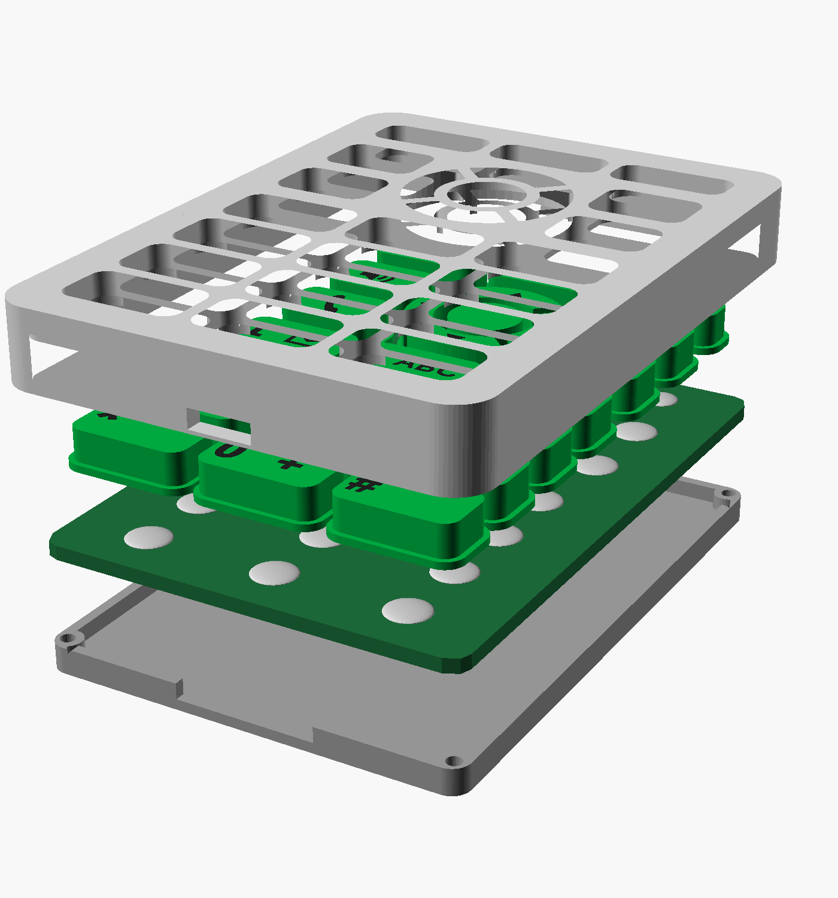

# T9KB

A tiny phone-style keypad for DIY projects that talks I2C. Plug it into an ESP32 *(or anything with Qwiic / I2C)* and you get the full key layout of an old desk phone handset: 3 soft keys, a 5-way d-pad, call / end / speaker / mute, and the 3x4 number pad.

There are virtually no good small modules on the market for basic I2C text input. The [M5Stack CardKB](https://docs.m5stack.com/en/unit/cardkb_1.1) is about the only one, and it is a tiny QWERTY board. Nothing like it exists for T9, so I made this one for T9 phone-style input on my own projects, starting with a DIY VoIP phone.

The layout follows the Grandstream WP826 handset. Keys are metal snap domes on gold pads, the same way real phones do it, and 3D printed PLA keycaps go on top. A single TI TCA8418 scans the keys, so the board has no firmware to flash. The text side *(multi-tap, T9, key repeat)* lives in an Arduino library on the host.

**Status:** v0.3 hardware is designed and ready to order, not built or tested yet. The Arduino library compiles and its logic is tested on a PC, not yet on real hardware. The keycaps and case are printed and fit.

<p align="center">
  
  &nbsp;
  
</p>
<p align="center">
  
  &nbsp;
  
</p>

The 3D model for case and keycap design is `hardware/t9kb.step`.

## Arduino library

The library is in `library/` *(Arduino, compiles for the ESP32 core)*. Install it by copying or symlinking `library/` into your Arduino `libraries` folder as `T9KB`.

```cpp
#include <Wire.h>
#include <T9KB.h>

T9KB keypad;

void setup() {
	Wire.begin();
	keypad.begin(); // or keypad.begin(Wire, INT_GPIO, RST_GPIO) with the INT / RST pads wired
}

void loop() {
	keypad.update();
	while (keypad.available()) {
		T9Event ev = keypad.read(); // ev.key, ev.type (press / release / long / repeat), ev.code (raw key number)
	}
	uint8_t c;
	while ((c = keypad.getChar())) {
		// typed text, CardKB style
	}
}
```

Text entry through `getChar()`:

| Key            | Tap in Abc / abc / ABC                            | Long press | 123 mode             |
| -------------- | ------------------------------------------------- | ---------- | -------------------- |
| 2 to 9         | Letters, then the digit *(abc2, def3, ... wxyz9)* | The digit  | Digit                |
| 1              | `1 . , ' ? ! " -`                                 | 1          | 1                    |
| 0              | Space                                             | 0          | 0, long press `+`    |
| `*`            | Symbols *(below)*                                 |            | `*`                  |
| `#`            | `#`                                               | Next mode  | `#`, long press mode |
| Right soft key | Backspace *(auto-repeats)*                        |            | Backspace            |
| Arrows         | CardKB arrow codes *(auto-repeat)*                |            | Arrow codes          |

The `*` symbols, in order: ``. , ' ? ! " - ( ) @ / : _ ; + % * = < > $ [ ] { } \ ~ ^ # | ` &``

- **Live preview:** each tap sends the letter right away, and the next tap on the same key sends a backspace plus the next letter. Show the text as it comes in and the screen previews every letter as you cycle. `pending()` is true while the last letter can still change, so you can underline it. The letter is final after 800 ms or when another key is pressed.
- **Modes:** long press `#` cycles Abc, abc, ABC, 123. It starts in Abc, which capitalizes the first letter and any letter after `. `, `! ` or `? `. `setMode()` changes the mode from code.
- **Codes:** backspace `0x08`, left `0xB4`, up `0xB5`, down `0xB6`, right `0xB7`, the same values the M5Stack CardKB sends. `getChar()` returns 0 when nothing is waiting.
- **Events only:** OK, call, end, the left and middle soft keys, speaker and mute type nothing. Handle them from key events.
- **Events:** read them from the queue with `available()` / `read()`, or set a callback with `onKey()`. `isPressed()` works for every key, so combos like a soft key plus a digit work.
- **Timing:** `setTapTimeout()` *(800 ms)*, `setLongPress()` *(600 ms)* and `setRepeat()` *(500 ms delay, 80 ms rate)*.
- **Reading the keypad:** without INT the library polls every 10 ms over I2C. With INT wired it only reads when a key event is waiting.

| Example     | What it shows                                                        |
| ----------- | -------------------------------------------------------------------- |
| `Text`      | Line editor on the serial monitor with live preview and mode display |
| `Events`    | Prints every key event with its raw key number                       |
| `Dialer`    | 123 mode phone dialer using the `onKey()` callback, Call and End     |
| `DeepSleep` | ESP32 deep sleep, woken by a keypress on the INT wire                |

T9 word prediction is planned for later.

## Keys

One rigid PLA keycap per key, with no web or membrane. Each cap has a 0.75 mm flange underneath that the case plate holds in, and a small rigid plunger that rests on its dome. Only the dome pushes back, so every key takes the dome's own force and keeps its click. Caps are green with black digits, letters and icons in the top 0.2 mm. Each cap leaves 0.10 mm around it in its plate hole (`GROW`), and the 2.56 mm plate makes deep holes that guide the caps, so pressing a wide key near one end barely tips it.

<p align="center">
  
  &nbsp;
  
</p>

| File                         | What                                             |
| ---------------------------- | ------------------------------------------------ |
| `keys/t9kb_keys_caps.stl`    | All 24 caps, face down for printing              |
| `keys/t9kb_keys_legends.stl` | Black legends, lined up with the caps            |
| `keys/t9kb_keys.scad`        | OpenSCAD source with all dimensions as parameters |

Legends: digits and letters on the number keys, an envelope *(voicemail)* on 1, speaker, muted microphone, call and hang up icons on the side keys, a line on each soft key, and arrows on the d-pad. The center select key is blank. Every stroke and every gap is at least 0.36 mm, so a 0.4 mm nozzle prints them all.

Printing *(Bambu A1 mini, PLA, textured plate)*: `build/slice.py` slices every part with OrcaSlicer into ready-to-print `.gcode.3mf` files in `build/out/`:

| File                             | What                                                                         |
| -------------------------------- | ---------------------------------------------------------------------------- |
| `keys_2color_MANUAL.gcode.3mf`   | Green caps, black legends: load black first, the printer pauses once in the first layer for green |
| `case_top.gcode.3mf`             | Case top only                                                                |
| `case.gcode.3mf`                 | Case top and lid                                                             |

The caps print face down at 0.12 mm layers after a 0.2 mm first layer, so the legends are exactly the first layer. No supports.

| Part     | Size                                                                         |
| -------- | ---------------------------------------------------------------------------- |
| Caps     | Key sizes from the layout, 4.36 mm tall, stick out of the plate 1.0 mm        |
| Flange   | 0.75 mm wide, 0.8 mm thick, stops under the plate                            |
| Plungers | 1.2 mm on 5 mm domes, 1.0 mm on 4 mm domes *(Snaptron: at most 25% of the dome)* |
| Tip      | 0.40 mm above the board, resting on the dome                                 |
| D-pad    | 8 mm center key and 4 arrows, each with its own stop on the plate             |

`TIP` in `t9kb_keys.scad` is where the plunger meets the dome. ButtonWorx publishes no dome height; 5 mm round domes run 0.24 to 0.38 mm and the peel-and-stick film adds about 0.05 mm, so 0.40 leaves at most about 0.1 mm of free play. If the keys feel pre-pressed or don't click, raise it to 0.52. Keep `TOP - TIP` a multiple of the 0.12 mm layers after the 0.2 mm first one, then re-export and re-slice:

```
build/export.sh          # keycap and case STLs
python3 build/slice.py   # every .gcode.3mf
```

`slice.py` runs the OrcaSlicer 2.4.2 AppImage extracted to `~/dev/tools/orca/squashfs-root` *(`--appimage-extract`, needs `libwebkit2gtk-4.1-0` and `xvfb`)* with its stock Bambu A1 mini, Bambu PLA Basic and 0.12 mm Fine / 0.20 mm Standard profiles.

## Case

A 3D printed two-part case: a top shell with a hole for every key and a back lid. The keycaps and board drop into the top shell face down, then 4 M1.4 self-tapping screws go through the lid and the board's corner holes *(H1-H4)* into the face plate and clamp the stack together.

<p align="center">
  
  &nbsp;
  
</p>
<p align="center">
  
</p>

| File                     | What                                               |
| ------------------------ | -------------------------------------------------- |
| `case/t9kb_case_top.stl` | Top shell, already flipped plate down for printing |
| `case/t9kb_case_lid.stl` | Back lid, floor down                               |
| `case/t9kb_case.scad`    | OpenSCAD source with all dimensions as parameters  |

| Part      | Size                                                                        |
| --------- | --------------------------------------------------------------------------- |
| Outside   | 52.6 x 72.6 x 8.8 mm                                                        |
| Walls     | 2.0 mm                                                                      |
| Top plate | 2.56 mm, deep key holes that keep the keys from tipping; keys stick out 1.0 mm |
| Spacer    | 1.6 mm under the plate, a pocket for every keycap flange; rests on a 1.0 mm rim at the board edge, the rest stays 0.3 mm off the board clear of the dome adhesive |
| Key holes | 0.25 mm around the key outline, 0.10 mm around each cap; a 1.4 mm ring and spokes split the d-pad |
| Lid       | 1.2 mm floor, 1.2 mm skirt that holds the board against the spacer, a 3.4 mm boss under each board corner |
| Screws    | 4 x M1.4 x 8 mm self-tapping pan head *(PH00)*: 1.7 mm holes in the lid, 1.5 mm holes in the board, 1.2 mm pilots that stop 0.56 mm under the face |
| Openings  | Qwiic slot on the top edge and a window in the lid for the jack, wire hole on the bottom edge for the J2 pads |
| Inside    | 1.8 mm under the board for the parts *(tallest is U1, 0.8 mm; the 2.96 mm Qwiic jack sits in the lid window, flush with the back)* |

Print both parts in PLA or PETG. 0.2 mm layers, 3 walls, no supports needed. The top shell prints plate down, so the face comes out flat.

Assembly:

1. Lay the top shell face down and drop every keycap into its hole from the inside, flange down.
2. Stick the domes on the board, then lay the board key face down onto the spacer.
3. Feed any J2 wires out through the bottom hole.
4. Set the lid in from the back and drive the 4 screws until snug. The first time they cut their own thread in the pilots, so don't overtighten.

## Specs

| Item        | Value                                                                               |
| ----------- | ----------------------------------------------------------------------------------- |
| Board size  | 48 x 68 mm, 1.6 mm thick, 2 layers, 2 mm corner radius                              |
| Keys        | 24 metal dome pads *(Snaptron patterns: 17 for 5 / 5.3 mm domes, 7 for 4 mm domes)* |
| Controller  | TI TCA8418 keypad scanner, no firmware                                              |
| I2C address | 0x34 *(fixed)*                                                                      |
| Power       | 3.3 V only *(1.65 to 3.6 V)*                                                        |
| Connector   | Qwiic / STEMMA QT *(JST SH 4-pin)*, top edge, parts side                            |
| Key face    | Flat: gold dome pads and legends only *(KiCad bottom layer)*                        |
| Parts side  | All parts *(8 total, KiCad top layer)*                                              |

## Key layout

All sizes in mm, measured on the key face. The key area is 43 x 63, centered on the board with a 2.5 border on every side.

| Keys         | Count | Size                          | Dome |
| ------------ | ----- | ----------------------------- | ---- |
| Soft keys    | 3     | 13 x 5                        | 4 mm |
| D-pad ring   |       | 18 circle                     |      |
| D-pad center | 1     | 10.5 circle                   | 5 mm |
| D-pad arrows | 4     | In the ring around the center | 4 mm |
| Side keys    | 4     | 10.5 x 7, two on each side    | 5 mm |
| Number keys  | 12    | 13 x 7                        | 5 mm |

| Gap                                    | Size |
| -------------------------------------- | ---- |
| Between soft keys, between number keys | 2    |
| Soft keys to d-pad                     | 3    |
| Soft keys to side keys                 | 3.5  |
| Between the 2 stacked side keys        | 3    |
| D-pad to number keys                   | 3    |
| Side keys to number keys               | 3.5  |

The outer edges of the soft keys, side keys and number keys all line up.

## Connections

Qwiic connector *(J1)*:

| Pin | Signal |
| --- | ------ |
| 1   | GND    |
| 2   | 3.3V   |
| 3   | SDA    |
| 4   | SCL    |

Breakout pads on the bottom edge of the parts side *(J2, 2.54 mm pitch, solder wires or an SMD header)*:

| Pad | Signal | Notes                                                         |
| --- | ------ | ------------------------------------------------------------- |
| 1   | GND    |                                                               |
| 2   | 3V3    |                                                               |
| 3   | SDA    |                                                               |
| 4   | SCL    |                                                               |
| 5   | INT    | Goes low when a key event is waiting *(10k pull-up on board)* |
| 6   | RST    | Pull low to reset the TCA8418 *(10k pull-up on board)*        |

Qwiic has no spare wire for INT. Over Qwiic alone the host polls the keypad; solder a wire from J2's INT pad to a GPIO for interrupt-driven reads and wake-on-keypress.

The board has 4.7k I2C pull-ups through the 3-pad solder jumper JP1. It comes bridged. If you chain it with other boards that already have pull-ups, cut both copper bars on JP1.

## Key map

The TCA8418 reports a key number from 1 to 80 *(`row * 10 + column + 1`)*. Bit 7 of the event byte is 1 for press, 0 for release.

| Key         | Row | Col | Key number |
| ----------- | --- | --- | ---------- |
| 1           | 0   | 0   | 1          |
| 2           | 0   | 1   | 2          |
| 3           | 0   | 2   | 3          |
| Soft left   | 0   | 3   | 4          |
| Soft middle | 0   | 4   | 5          |
| Soft right  | 0   | 5   | 6          |
| 4           | 1   | 0   | 11         |
| 5           | 1   | 1   | 12         |
| 6           | 1   | 2   | 13         |
| Speaker     | 1   | 3   | 14         |
| Up          | 1   | 4   | 15         |
| Mute        | 1   | 5   | 16         |
| 7           | 2   | 0   | 21         |
| 8           | 2   | 1   | 22         |
| 9           | 2   | 2   | 23         |
| Left        | 2   | 3   | 24         |
| OK          | 2   | 4   | 25         |
| Right       | 2   | 5   | 26         |
| *           | 3   | 0   | 31         |
| 0           | 3   | 1   | 32         |
| #           | 3   | 2   | 33         |
| Call        | 3   | 3   | 34         |
| Down        | 3   | 4   | 35         |
| End         | 3   | 5   | 36         |

Minimum setup over I2C:

| Register | Name     | Write | Why                               |
| -------- | -------- | ----- | --------------------------------- |
| 0x1D     | KP_GPIO1 | 0x0F  | Rows 0 to 3 are keypad rows       |
| 0x1E     | KP_GPIO2 | 0x3F  | Columns 0 to 5 are keypad columns |
| 0x01     | CFG      | 0x01  | Interrupt on key events           |

Then read `KEY_LCK_EC` *(0x03)* for the event count, read `KEY_EVENT_A` *(0x04)* once per event, and write 0x01 to `INT_STAT` *(0x02)* to clear the interrupt.

The board has no diodes, so single keys and 2-key combos are reliable. Pressing 3 keys that form an L in the matrix can show a fake 4th key.

## Parts

Assembled by JLCPCB *(all on the parts side)*:

| Ref    | Part                        | Package         | LCSC    | JLC type |
| ------ | --------------------------- | --------------- | ------- | -------- |
| U1     | TCA8418RTWR                 | WQFN-24 4x4 mm  | C138713 | Extended |
| J1     | JST SM04B-SRSS-TB *(Qwiic)* | SMD right angle | C160404 | Extended |
| C1     | 100 nF                      | 0603            | C14663  | Basic    |
| C2     | 10 uF                       | 0603            | C19702  | Basic    |
| R1, R2 | 4.7k *(I2C pull-ups)*       | 0603            | C23162  | Basic    |
| R3, R4 | 10k *(RST, INT pull-ups)*   | 0603            | C25804  | Basic    |

Bought separately and added by hand:

| Qty | Part                                         | Where    | Notes                      |
| --- | -------------------------------------------- | -------- | -------------------------- |
| 20  | 5 to 5.3 mm metal domes *(see Dome sources)* | Varies   | 17 needed, rest are spares |
| 10  | 4 mm metal domes *(see Dome sources)*        | Varies   | 7 needed, rest are spares  |
| 1   | Kapton *(polyimide)* tape                    | Anywhere | Only for loose domes       |

## Dome sources

The pads follow Snaptron's published single-sided contact patterns: 17 pads for 5 / 5.3 mm domes and 7 pads for 4 mm domes *(soft keys and d-pad arrows)*. Prices and stock were checked on 2026-10-07.

From [ButtonWorx](https://buttonworx.com) *(Maine, US, $4 minimum order, no force listed)*:

| Pads | Part                                                                                                                    | Price      | Mounting                          |
| ---- | ----------------------------------------------------------------------------------------------------------------------- | ---------- | --------------------------------- |
| 5 mm | [Snap Dome Chopped Circle 5.2mm Peel & Stick](https://buttonworx.com/metal-domes/291-snap-dome-cut-circle-5-2x3-8.html) | $0.50 each | Built-in 7 mm square sticker      |
| 4 mm | [Snap Dome Round 4mm Dimple](https://buttonworx.com/metal-domes/284-snap-dome-round-4mmD.html), loose                   | $0.40 each | Loose: tape it down               |

The adhesive squares around neighboring d-pad domes may overlap; trim them if they do. A 4.5 mm dome does not fit the 4 mm pads.

## Ordering from JLCPCB

Upload `hardware/fab/t9kb_gerbers.zip` and use these settings:

| Setting        | Value                                               |
| -------------- | --------------------------------------------------- |
| Layers         | 2                                                   |
| Dimensions     | 48 x 68 mm *(auto-detected)*                        |
| Material       | FR-4                                                |
| PCB thickness  | 1.6 mm *(Economic PCBA only offers ENIG at 1.6 mm)* |
| Surface finish | ENIG *(required, the dome contacts need gold)*      |
| Gold thickness | 2U" *(1U" also works)*                              |
| PCB assembly   | Yes, Economic                                       |
| Assembly side  | Top side                                            |
| BOM / CPL      | `hardware/fab/BOM.csv` and `hardware/fab/CPL.csv`   |

On the placement preview page, check these before paying:

- **U1:** the dot on the chip lines up with the pin 1 triangle printed on the board.
- **J1:** the connector opening faces the top edge of the board.

If either is turned wrong, rotate it right there in the preview. Resistors and capacitors do not care.

## Assembly

1. Clean the key face with isopropyl alcohol.
2. Place a dome on each gold pad, centered on the round contact *(not on the small hole, which is off-center on purpose)*. The small pads *(soft keys and d-pad arrows)* take 4 mm domes, the rest take 5 mm domes. Four-leg domes go with a leg on each of the 4 cut corners of the gold frame.
3. Tape over the domes with Kapton tape, or use peel-and-stick domes. Air vents through the small hole in each center pad, so the tape can cover the domes fully.
4. Test by pressing each dome with a finger while reading key events.

A dome that sits crooked can be peeled off and placed again. Nothing on the key face is soldered.

## Rebuilding the board

The board is generated by script *(KiCad 9)*. There is no schematic; the netlist lives in `gen_pcb.py`.

```
cd hardware
./autoroute.sh    # place parts, autoroute with freerouting, pour ground, run DRC
python3 fab.py    # gerbers, drill files, BOM, CPL
```

`autoroute.sh` expects `freerouting.jar` in `tools/`. Download it from the [freerouting v2.0.1 release](https://github.com/freerouting/freerouting/releases/tag/v2.0.1) *(needs Java 21)*.

## References

- `ref/tca8418.pdf`: [TI TCA8418 datasheet](https://www.ti.com/lit/ds/symlink/tca8418.pdf)
- `ref/snaptron_guide.pdf`: Snaptron metal dome design guide *(contact pad patterns, plating, venting)*

## Notes

- The TCA8418 exposed pad is tied to ground, as TI recommends *(ground or floating, never power)*.
- Dome pads follow Snaptron's single-sided contact patterns for 5 / 5.3 mm and 4 mm domes, with the off-center via-in-pad option for 2-layer boards. There is no solder mask inside the pad area, per Snaptron.
- U1 uses TI's own land pattern and stencil for the RTW0024B package *(TCA8418 datasheet)*.
- The key face is the KiCad bottom layer so JLC assembles the top side.
- LEDs and backlight were removed for this revision. They may come back later.
